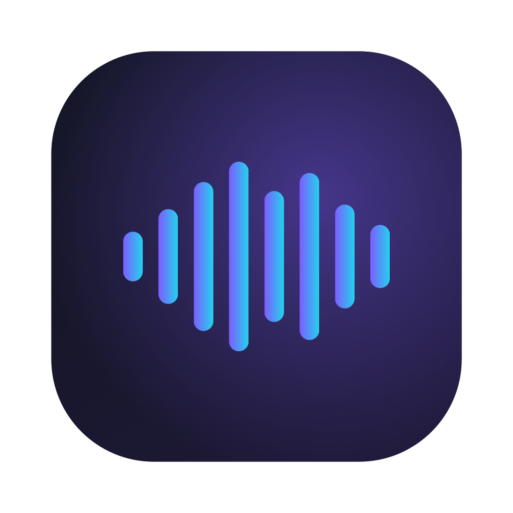
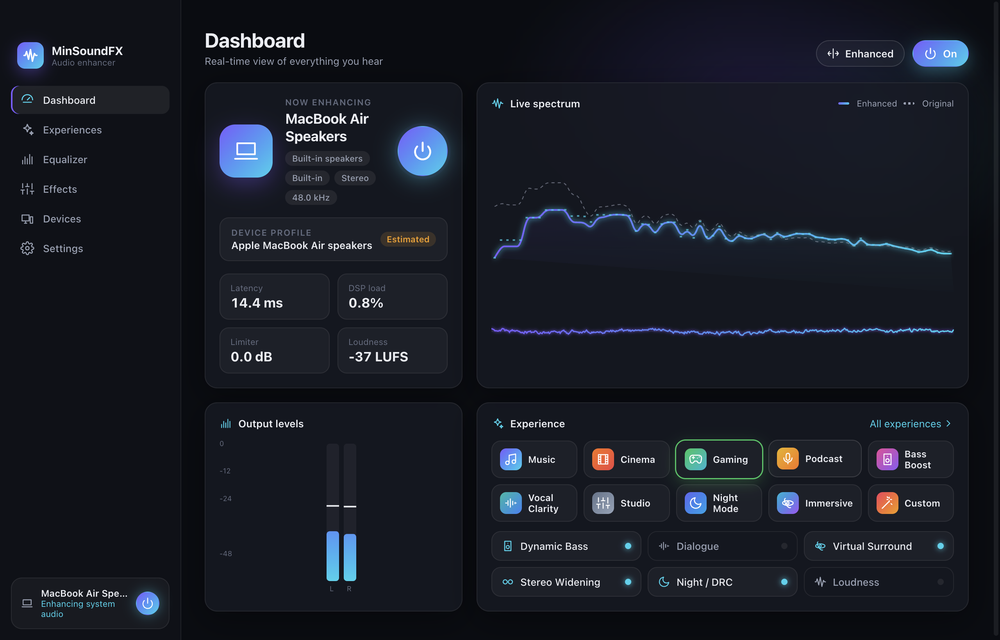
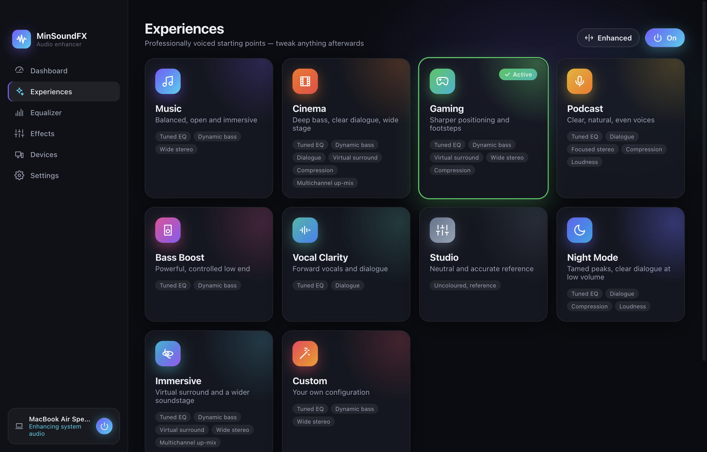
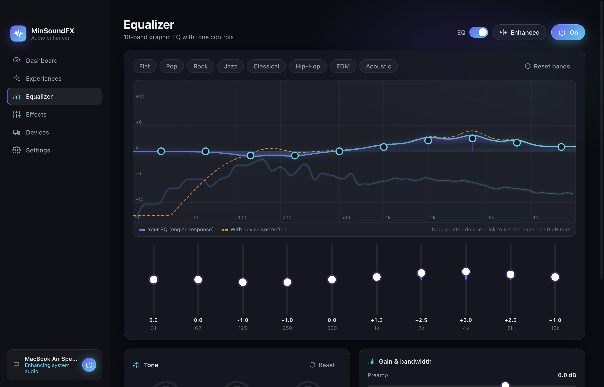
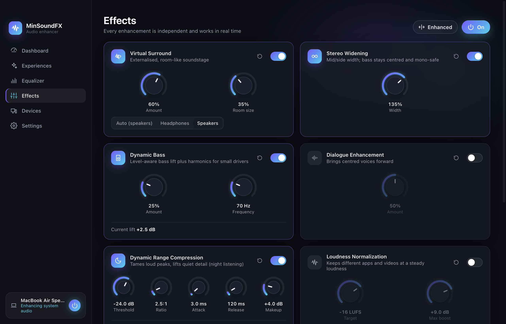
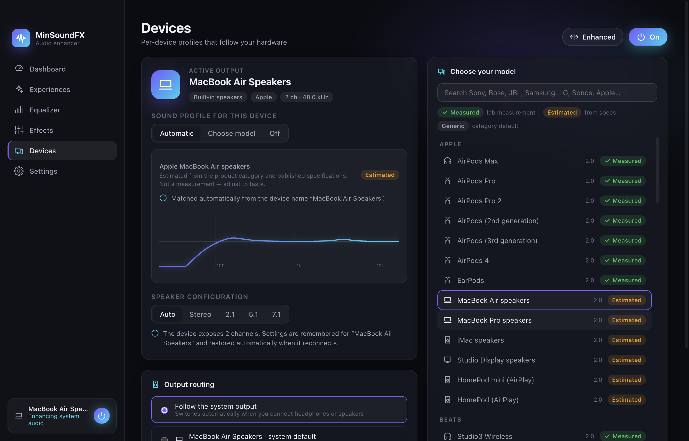
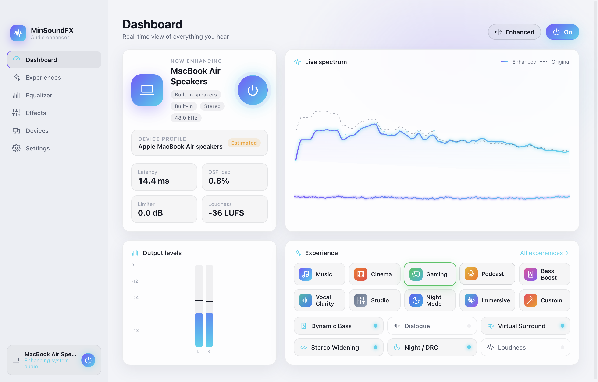
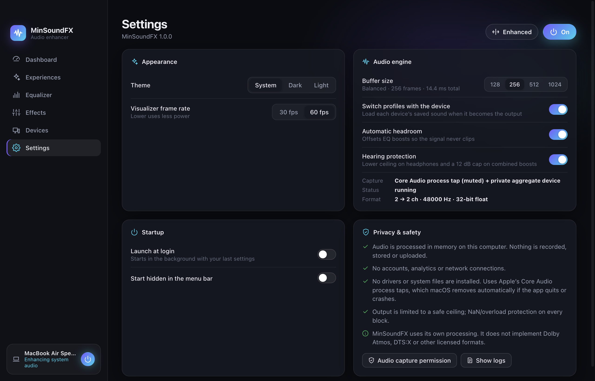
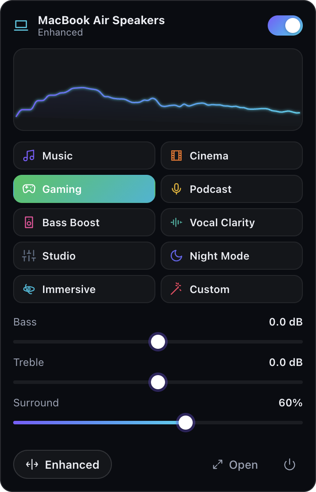

<div align="center">



# MinSoundFX

**Make everything your computer plays sound better: music, films, games, calls.**

A system-wide audio enhancer for macOS and Windows with a real-time native DSP engine:<br>
10-band EQ, measured headphone correction, virtual surround, dialogue, dynamic bass, loudness and night mode.<br>
Everything runs locally. No accounts, no network, nothing recorded.

[](https://github.com/Binwin6724/MinSoundFX/releases/latest)




</div>

---

## Why MinSoundFX?

Apps like Dolby Access, Boom 3D and FxSound show what a good audio layer can do for ordinary speakers and headphones. MinSoundFX is an open-source take on that idea, with its own processing engine and an emphasis on honesty:

- 🎧 **It processes real system audio.** Spotify, Apple Music, YouTube, Netflix, browsers, games: anything that plays through your output device. Every control drives the native engine in real time.
- 📏 **Device profiles say where they came from.** Headphone corrections marked **Measured** come from published lab measurements of that exact model ([AutoEq](https://github.com/jaakkopasanen/AutoEq), credited per profile). Speaker and soundbar profiles are marked **Estimated**; category defaults are marked **Generic**.
- 🛡️ **It protects your ears and your speakers.** A look-ahead limiter is always on, EQ boosts are offset automatically, and headphones get a lower ceiling.
- ↩️ **It never leaves your audio broken.** Turning it off, quitting, crashing or uninstalling always restores the normal audio path.
- 🔒 **It's private.** Audio is processed in memory and is never stored or sent anywhere. The app makes no network connections.

## Features

| | |
|---|---|
| **Dashboard** | Active output device with type, transport, channels and sample rate; live spectrum (enhanced vs. original); waveform; per-channel peak/RMS meters; latency, DSP load, limiter and loudness readouts; one-click experiences and effect toggles; power switch and **A/B compare** with a seamless 30 ms crossfade. |
| **Experiences** | Music, Cinema, Gaming, Podcast, Bass Boost, Vocal Clarity, Studio, Night Mode, Immersive, and Custom. Editing any control turns the result into your *Custom* sound, so predefined experiences are never overwritten. |
| **Equalizer** | Interactive 10-band graphic EQ: drag points on the graph or use the sliders. The curve is computed by the engine from the real filter coefficients, drawn over the live spectrum, with device correction shown separately. Includes Bass/Mid/Treble rotary controls, adjustable Q, and Pop, Rock, Jazz, Classical, Hip-Hop, EDM and Acoustic profiles. |
| **Presets** | Save, rename, update, apply and delete your own presets; they work on any device. |
| **Effects** | Virtual surround (headphone or speaker mode), stereo widening (bass stays centred, mono-safe), dynamic bass (level-aware lift plus harmonics), dialogue enhancement, dynamic range compression, loudness normalisation (ITU-R BS.1770), balance, preamp and output gain, and multichannel up-mix. Each one is independent and adjustable in real time. |
| **Devices** | Automatic recognition of headphones, earbuds, Bluetooth speakers, soundbars, TVs/HDMI, built-in and external speakers. **35 measured** headphone/earbud profiles (Sony, Bose, Apple, Beats, Samsung, JBL, Sennheiser) plus estimated profiles for Sony, Bose, JBL, Samsung, LG, Sonos and Apple speakers and soundbars. Pick your model by hand, choose Stereo / 2.1 / 5.1 / 7.1, or pin an output. |
| **Per-device memory** | Each device remembers its own sound. When it reconnects, its profile is restored automatically. |
| **Mini player** | Menu-bar (macOS) / system-tray (Windows) popover with spectrum, experiences, bass/treble/surround and compare. Closing the window keeps processing running in the background. |
| **Settings** | Dark/light/system theme, buffer size (latency vs. power), hearing protection, automatic headroom, launch at login, and logs. |

## Screenshots

<table>
<tr>
<td><br><sub><b>Experiences</b>: ten tuned starting points</sub></td>
<td><br><sub><b>Equalizer</b>: engine-computed response over the live spectrum</sub></td>
</tr>
<tr>
<td><br><sub><b>Effects</b>: independent real-time enhancements</sub></td>
<td><br><sub><b>Devices</b>: measured, estimated and generic profiles</sub></td>
</tr>
<tr>
<td><br><sub><b>Light theme</b></sub></td>
<td><br><sub><b>Settings</b>: engine, safety and privacy</sub></td>
</tr>
</table>

<p align="center"><br><sub><b>Menu-bar / tray mini player</b></sub></p>

<sub>Screenshots were captured from the real app while it processed audio on a MacBook Air (`--capture-screenshots`).</sub>

## Download & install

### macOS (14.2 Sonoma or later; Apple silicon or Intel)
1. Download **`MinSoundFX-x.y.z-mac-arm64.dmg`** (Apple silicon) or **`-mac-x64.dmg`** (Intel) from the [latest release](https://github.com/Binwin6724/MinSoundFX/releases/latest).
2. Open the DMG and drag **MinSoundFX** into **Applications**.
3. **First launch:** release builds are ad-hoc signed but not notarized by Apple, so macOS warns the first time. Right-click MinSoundFX and choose **Open**, then **Open** again. Or run:
   ```bash
   xattr -dr com.apple.quarantine /Applications/MinSoundFX.app
   ```
4. Press the power button. macOS asks for **System Audio Recording** permission. Allow it; this is how MinSoundFX receives the audio it enhances. You can review it later in System Settings ▸ Privacy & Security ▸ Screen & System Audio Recording.

**Uninstall:** quit MinSoundFX from the menu bar and delete it from Applications. Nothing else is installed.

### Windows 10 / 11 (x64)
1. Install a virtual audio endpoint. The free **[VB-Audio VB-CABLE](https://vb-audio.com/Cable/)** works well. MinSoundFX detects it automatically.
2. Download and run **`MinSoundFX-x.y.z-win-x64-setup.exe`** from the [latest release](https://github.com/Binwin6724/MinSoundFX/releases/latest). The installer is not code-signed yet, so SmartScreen may warn: choose *More info ▸ Run anyway*.
3. Press the power button. MinSoundFX makes the virtual cable your default output, processes it, and plays the result on your real device.

**Uninstall:** use *Settings ▸ Apps*. The uninstaller restores your original default output device first.

> **Why a virtual cable on Windows?** Windows has no public API that lets an app replace the system mix. The alternatives are a kernel-signed APO driver or a virtual endpoint, and MinSoundFX doesn't install drivers. See [docs/LIMITATIONS.md](docs/LIMITATIONS.md).

## How it works

```
 Spotify / YouTube / games ──► system mix ──► capture ──► MinSoundFX engine ──► your speakers / headphones
                                               │
              macOS: Core Audio process tap (muted, private) + private aggregate device
            Windows: WASAPI loopback of a virtual endpoint + event-driven render (MMCSS)

 Engine (C++17, real-time safe, no allocations or locks on the audio thread):
 channel map ► preamp + auto-headroom ► device correction ► 10-band EQ + tone ► dialogue ► dynamic bass
 ► stereo widener ► virtual surround ► compressor ► loudness AGC ► balance/output ► look-ahead limiter
 ► crossfade with the latency-aligned original (A/B)
```

* **macOS:** a muted Core Audio *process tap* captures what other apps send to your output device and silences the original path. The engine output goes to the same device through a private aggregate device. Our own process is excluded from the tap, so there's no feedback. Nothing is installed and no system setting changes. If the app quits or crashes, macOS removes the tap and normal audio resumes instantly.
* **Windows:** apps play into the virtual endpoint; MinSoundFX captures it with WASAPI loopback, keeps the two device clocks locked with an adaptive resampler, and renders to your real device. The original default output is restored on stop, quit, uninstall and, after a crash, on the next launch.
* **Device changes:** plugging in headphones, Bluetooth connects and disconnects, sample-rate and channel-layout changes rebuild the pipeline automatically and load that device's saved sound.

**Performance:** the full chain with every effect enabled uses about **0.5 % of one core** (stereo, Apple M-series) and ~1 % for 5.1. End-to-end latency is about **14 ms** at the default 256-frame buffer on a MacBook Air.

More detail: [docs/ARCHITECTURE.md](docs/ARCHITECTURE.md) · [docs/SAFETY.md](docs/SAFETY.md) · [docs/LIMITATIONS.md](docs/LIMITATIONS.md)

## Build from source

Requirements: Node.js 22+, Python 3, and a C++17 toolchain (Xcode Command Line Tools on macOS, Visual Studio 2022 Build Tools on Windows).

```bash
git clone https://github.com/Binwin6724/MinSoundFX.git
cd MinSoundFX
npm install
npm test            # 32 native DSP tests + 37 unit tests
npm run dev         # Vite + Electron (UI development)
npm run dist:mac    # → release/MinSoundFX-<version>-mac-<arch>.dmg
npm run dist:win    # → release/MinSoundFX-<version>-win-x64-setup.exe
```

On macOS, system-wide capture needs the packaged app (it carries the required `NSAudioCaptureUsageDescription`). To check an installation end to end:

```bash
open -W /Applications/MinSoundFX.app --args --self-test 10   # logs real input/output levels, then stops
```

## Project layout

```
native/src/dsp/        C++ engine: filters, dynamics, spatial effects, analyser, engine
native/src/platform/   macOS (Core Audio taps) and Windows (WASAPI) backends
native/src/addon.cpp   Node-API bindings
native/tests/          DSP, safety and performance tests
shared/                Presets, device recognition & profiles, safety rules (unit-tested)
electron/              Main process: controller, persistence, tray, IPC, logging
src/                   React UI (canvas visualisers, EQ graph, knobs)
```

## Honest notes

* MinSoundFX's surround, spatial and up-mix effects are its own processing. It does **not** implement or claim Dolby Atmos, DTS:X, THX or any other licensed format.
* "Measured" profiles correct a headphone toward a neutral target using third-party measurements of that model; your unit, fit and ear tips still matter.
* See [docs/LIMITATIONS.md](docs/LIMITATIONS.md) for what MinSoundFX can't do (for example, exclusive-mode audio on Windows).

## Contributing

Issues and pull requests are welcome. See [CONTRIBUTING.md](CONTRIBUTING.md). Changes to gain staging or safety need tests.

## License

[MIT](LICENSE) © Binwin Viju. Measured headphone corrections are derived from [AutoEq](https://github.com/jaakkopasanen/AutoEq) (MIT).
